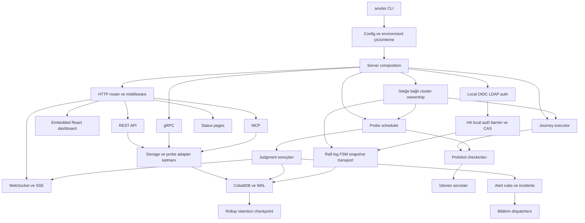

# AnubisWatch mimari ve tamamlanma incelemesi

Güncel takip: Kullanıcının binary/Docker hedefi için F89–F97 düzeltildi ve son
yerel adayın kabulü tamamlandı. [Tamamlanma sonucu](2026-10-26-binary-docker-completion.md)
güncel kod, paket ve test durumunu verir. Aşağıdaki inceleme, düzeltmelerden
önceki bulguları ve daha geniş mimari kapsamı tarihsel kanıt olarak korur.

Tarih: 26 Ekim 2026. İncelenen taban: `3653a0a` commit'i ve inceleme başlangıcındaki mevcut çalışma ağacı. Bu rapor yalnızca commit içeriğini değerlendirmez; henüz commitlenmemiş ürün kodunu ve testleri de kapsar.

**Karar: AnubisWatch geniş özellik kapsamına ve çalışan bir çekirdeğe sahip; ancak mevcut haliyle yayına hazır kabul edilemez.** Bu incelemede dört ürün hatası yeniden üretildi. Bağımlılık güvenlik kontrolü ve biçim kontrolü de başarısız. Bunlara ek olarak son kaynak kodunu kapsayan sürüm kabulü, hedef ortam doğrulaması ve ürün kapsamının dondurulması gerekiyor.

Sorun, her özelliğin eksik olması değil. İzleme ürünüyle birlikte özel depolama motoru, özel consensus uygulaması, kimlik sistemi, çoklu API yüzeyi ve dağıtım araçlarının bakım yükü üstlenilmiş. Projeyi bitirmek için bu yükü yeni özelliklerle büyütmek yerine desteklenen sınırları belirlemek ve mevcut davranışları kapatmak gerekiyor.

## İncelemenin kapsamı ve kanıt düzeyleri

İnceleme; CLI ve server composition, domain/config, storage, probe, Journey, alert, cluster/Raft, auth, REST/gRPC/MCP, WebSocket/SSE, status page, dashboard, backup, telemetry, frontend, CI/release, Docker, Helm, işletim scriptleri ve mevcut kabul dokümanlarını kapsar.

Bu genişlik, bütün satırların ve bütün hata kombinasyonlarının eksiksiz doğrulandığı anlamına gelmez. Kritik yaşam döngüleri ve veri yolları doğrudan okundu; repo yapısı ve kaynak/test envanteri çıkarıldı; mevcut testler ve dört bağımsız hata kanıtı çalıştırıldı. Canlı production ortamı kullanılmadı.

| Sınıf | Anlamı |
| --- | --- |
| Çalıştırılarak doğrulandı | Bu turda mevcut kod üzerinde test, build veya hata kanıtı çalıştı. |
| Kaynakta mevcut | Uygulama ve bağlantısı kodda görüldü; bütün dış servis kombinasyonları denenmedi. |
| Önceki yerel kabul | Önceki aday için kaydedilmiş sonuç; bugünkü kaynak kodunun kabulü yerine geçmez. |
| Eksik veya desteklenmiyor | Kaynakta açıkça uygulanmayan, reddedilen ya da ürün akışı tamamlanmayan yetenek. |
| Mimari risk | Tasarımın maliyeti veya test edilmesi gereken sınır; yeniden üretilmiş yeni hata değildir. |

Başlangıçta 78 izlenen dosyada değişiklik, 116 untracked durum girdisi vardı. Untracked dizinler açılarak toplam 208 mevcut dosyanın hash'i kaydedildi. Bu 208 dosyanın tamamı inceleme sonunda aynı kaldı. Ürün kodu düzeltilmedi; bu tur analiz ve raporlama turudur.

Envanter: 97 elle yazılmış Go dosyasında 53.833 satır; 392 Go test dosyasında 120.867 satır ve 3.791 `Test...` fonksiyonu; ayrıca iki üretilmiş protobuf dosyasında 6.021 satır. Frontend `src` altında 51 kaynak dosyasında 13.088 satır ve 93 test dosyasında 10.818 satır var. Satır sayıları boşlukları ve yorumları içerir; CSS, YAML ve shell dosyaları bu sayılara dahil değildir.

## Mevcut mimari

### Sürecin kurulması ve kapanması

Ana giriş `cmd/anubis/main.go`; nesneleri birleştiren yer `cmd/anubis/server.go`. `BuildServerDependencies` config, telemetry, storage, auth, cluster, alert, probe, Journey ve API nesnelerini kurar. `Server.Start` bakım işlerini, alarm yöneticisini, görev atamasını ve listener'ları başlatır.

Standalone modda stored/configured Soul ve Journey kayıtları yerel scheduler'a atanır. Cluster modunda `clusterWork` sahipliği hesaplar; her Soul'ü tek owner çalıştırır, sonuçlar diğer voter'lara replike edilir. API yazıları ortak adapter üzerinden consensus'a yönlenir.

HTTP ve gRPC başlatma hatalarının sunucuyu başarısız durdurması uygulanmış. Kapanış; API, Journey, alarm, replication flush, cluster, probe ve storage bakım nesnelerini sırayla durdurur. **İleri inceleme:** probe üreticisi cluster flush/stop sonrasında durduruluyor. Kapanış sırasında hâlâ üretilen sonucun teslimi için gated test gerekir; bu turda veri kaybı olarak kanıtlanmadı.

### Domain ve konfigürasyon

`internal/core`: Soul hedefi, Judgment sonucu, Verdict/Incident alarm yaşam döngüsünü, Journey senaryoyu temsil eder. Workspace kimliği depolama ve API yetki sınırlarının parçasıdır. Status değerleri `alive`, `dead`, `degraded`, `unknown`, `embalmed`.

`core.LoadConfig` YAML/JSON okur, environment genişletir, override ve defaults uygular, validate eder. Başlangıç kodunda ayrıca CLI/environment çözümlemesi bulunur. Bu, ayar önceliğinin iki yerde bakımını gerektirir. Canonical örnek `configs/anubis.yaml`; varsayılan kod portu 8443, örnek ve container portu 8080'dir.

**Tasarım sınırı:** modelde bir alanın varlığı, o alanın uygulandığını göstermiyor. Tenant quota, branding ve redundancy bunun somut örnekleri.

### CobaltDB ve veri yaşam döngüsü

`internal/storage/engine.go`: verinin byte değerleri ve B+Tree düğümleri bellekte, kalıcılık WAL üzerinden sağlanır. Başlangıçta WAL yeniden oynatılır; ikincil ID/workspace indeksleri kurulur. Dizin kilidi aynı veri dizinine ikinci yazarı engeller. Yazma sırası, WAL append ve bellek yayını kilitlerle koordine edilir. AES-GCM şifreleme seçeneği vardır.

`judgments.go` ham sonuçları, `timeseries.go` özetleri, `retention.go` saklama süresini, `raft_log.go` Raft log/snapshot verilerini yönetir. Son değişikliklerde Judgment, indeks ve rollup yazılarının atomik WAL batch içinde tutulması eklenmiş; bunun regresyon testleri mevcut.

Bu motor disk üzerinde sayfalama yapan ve küçük cache ile bütün veriyi yöneten bir veritabanı gibi değerlendirilmemeli. Tutulan verinin büyüklüğü bellek, replay ve snapshot maliyetini artırır. API sorguları ve metrics de aynı süreçte çalışır. Kullanılabilir RAM ve restart süresi için açık kapasite sınırı gerekiyor.

Örnek yük hesabı: 1.000 Soul, 60 saniye aralıkla günde yaklaşık 1,44 milyon Judgment üretir; yedi günlük ham saklama yaklaşık 10,08 milyon kayıttır. Bir saniye aralıkta günlük sayı 86,4 milyondur. Bunlar adet hesabıdır; byte/RAM garantisi değildir. HA'da kayıtlar voter'lara replike edildiği için cluster kullanmak, ham depolamayı yatay bölmek anlamına gelmez.

Yeni WAL `BATCH` ve chunk snapshot formatları eski binary'lerle güvenli downgrade sınırına sahiptir. Eski binary'yi yeni veri dizininde açmak rollback yöntemi değildir. Runbook'taki ayrı boş dizine eski yedekten dönme prosedürü korunmalı.

### Probe ve Journey

`internal/probe/checker.go` on checker kaydeder: HTTP, TCP, UDP, DNS, SMTP, IMAP, ICMP, gRPC, WebSocket ve TLS. UDP/IMAP yalnızca veri modeli değildir; uygulamaları vardır. `ARCHITECTURE.md` içindeki bu iki protokole ilişkin model-only ifadeleri güncel değildir.

`Engine`: Soul başına görev yaşam döngüsü, concurrency semaphore, timeout/cancellation, circuit breaker, persistence, alarm ve live callback sorumluluklarını taşır. Varsayılan concurrency 100. Server wiring bu değeri ayrı runtime ayarından almıyor; ileri kapasite ayarı için config sözleşmesi gerekiyor.

HTTP ve diğer checker'larda SSRF/private-network ve TLS politikası bulunur. İç servisleri izlemek için açık CIDR/allow-private politikası gerekir. İlgili izinlerin Helm üzerinden nasıl verileceği henüz tam ürünleştirilmemiştir.

`internal/journey/executor.go`: protokol adımları, değişken taşıma, extraction, assertion, cookie/context, toplam timeout ve periyodik çalışma sağlar. Bu, tarayıcı çalıştıran bir synthetic motor değildir; JavaScript uygulama akışını gerçek browser ile yürüten ayrı bir runtime kaynakta görülmedi.

Manuel HA Journey kaydı consensus ve yerel apply sonucunu bekleyen ayrı saver kullanır; scheduled kayıtlar batch yolunu kullanır. Bu ayrım son düzeltmelerden biridir ve eski kabul image'ı ile aynı sayılmamalıdır.

### Alarm ve olay yönetimi

`internal/alert`: rule evaluation, durum değişimi, süre/eşik/başarısızlık geçmişi, dedup, cooldown, queue, retry, escalation ve incident acknowledgement/resolution içerir. Slack, Discord, email, PagerDuty, OpsGenie, ntfy, Telegram, Twilio SMS ve webhook dispatcher'ları mevcut.

Queue overflow/dedup sahipliği, workspace filtreleme, failure-rate window ve ownership geri dönüşünde geçmişten seed etme için regresyon testleri var. Bunlar önceki audit bulgularının çalışma ağacında giderildiğini gösteren önemli tamamlanmış işlerdir.

**Sözleşme eksiği:** süreç çökmesi ve partition sırasında bildirim tesliminin garanti düzeyi açık ürün sözleşmesine dönüşmemiş. Retry/dedup bulunması exactly-once teslimi kanıtlamaz. Harici sağlayıcı onayı ile yerel durum yazısı arasındaki sınır için durable outbox/idempotency gereksinimi kararlaştırılmalı; bütün sistemi bu turda bozuk ilan etmek için kanıt yok.

### Cluster ve Raft

`internal/cluster`: üyelik/liveness, yük ve bölgeye göre ownership, rebalance, command batching. `internal/raft`: election/pre-vote, term/log/commit, FSM apply, forwarding, membership değişimi, snapshot ve authenticated TCP transport.

Desteklenen chart topolojisi opt-in **üç sabit voter, local auth, doğrulanmış peer mTLS ve voter başına ayrı kalıcı disk**. HPA/arbitrary membership scaling, HA OIDC/LDAP ve aynı release üzerinde standalone↔HA geçişi desteklenmiyor. Bunları reddeden guard'lar kaldırılması gereken gereksiz engeller değildir.

Raft logunun uygulanması, snapshot yayınlama/restore, eski election sonucunu engelleme ve transport kilit izolasyonu üzerinde kapsamlı yakın dönem düzeltmeler var. Bunlar sistemin güvenilirliği için değerli, aynı zamanda özel consensus bakım yükünün somut göstergeleridir.

`cluster.Batcher` en çok 10.000 pending command tutar; taşmada en eski komutları düşürür. Bu, mevcut kodun açık davranışıdır. Scheduled sonuçlar için enqueue başarısı quorum kalıcılığı demek değildir. Dayanıklılık dokümanı bu sınırı ve kayıp gözlemlenebilirliğini açıkça söylemeli.

### Auth ve tenant sınırları

Local auth: bcrypt, token/session persistence, parola değişimi/reset, logout, lockout ve workspace switching. Standalone OIDC/LDAP uygulamaları var. HA local auth `Barrier` + ortak state + CAS ile çalışır; auth belirsizliğinde erişim kapalı kalır.

HA'da her Authenticate ortak authority'yi yenilemek için quorum bariyeri kullanır. Bu güçlü revocation davranışı sağlar, fakat auth okumasını consensus yazma maliyetine bağlar. Ortak auth state limiti 192 KiB'dir. Dashboard/API/scrape hacmi, kullanıcı/oturum sayısı ve leader latency birlikte kapasite testine girmeli.

Workspace prefix ve API resource checks uygulanmıştır; fakat tenant kotaları ve ticari feature enforcement tamamlanmamıştır. Kullanıcı/üye daveti, rol atama ve tam kullanıcı yönetimini bitmiş saymak için yeterli REST/UI akışı yok: route listesinde kullanıcı için esas olarak `me` alias'ı var. Member ve quota modellerinin varlığından tam ekip yönetimi sonucu çıkarılmamalı.

### API yüzeyleri ve gerçek zamanlı yayın

REST; Souls/Judgments, channels/rules, incidents, journeys/runs, workspaces, config, status pages, maintenance, dashboards, cluster ve auth uçlarını sağlar. Middleware: request ID, logging/audit, security headers, CORS, recovery, JSON/path validation ve rate limit.

gRPC yönetim yüzeyi, stream'ler, auth ve method permissions ile uygulanmış. Üretilmiş protobuf dosyalarındaki `Unimplemented...` metotları standart fallback scaffold'udur; bunları arama sonucunda görüp bütün gRPC'yi yapılmamış saymak yanlış olur.

MCP ortak adapter'larla yetki ve workspace sınırlarını kullanır. WebSocket/SSE; event yayını, workspace scoping ve lifecycle yönetimi içerir. REST/gRPC/MCP'nin birlikte desteklenmesi her mutasyonda üç ayrı sözleşmenin testini gerektirir. Alias endpoint'leri de bakım yüzeyini büyütür.

### Dashboard ve status pages

React 19, TypeScript, Vite, Zustand, React Router ve Recharts kullanılıyor. Ana sayfalar: Dashboard, Souls, Soul detail/edit, Judgments, Alerts, Incidents, Maintenance, Journeys, Cluster, StatusPages, custom dashboards ve Settings. Route lazy loading, theme, timezone, error boundary, confirm dialog ve workspace switcher mevcut.

Frontend client, backend domain/status/duration ile UI tipleri arasında normalization yapıyor. Bu yararlı bir uyumluluk katmanı; fakat aynı kavramın birden fazla gösterimi ve elle tutulan tipler sözleşme sapması riski taşıyor. OpenAPI/protobuf ve frontend modellerinin hangi kaynaktan üretildiği veya eşitlendiği netleştirilmeli.

Status page: public/private/password-protected HTML, JSON, badge/widget/feed, custom domain lookup, uptime ve maintenance sunumu var. Domain/TLS provisioning operatör işidir; alanın kaydedilmesi otomatik DNS/sertifika kurulumu anlamına gelmez.

Subscription endpoint'i kayıt yaratıp “confirm” mesajı döndürüyor. Kaynak taramasında bu subscription'ları doğrulayan ve incident değişiminde tüketip bildirim gönderen tamamlanmış akış görülmedi. Bu işlev yayımlanacaksa confirmation, unsubscribe, teslim, kötüye kullanım ve recipient verification tamamlanmalı; aksi durumda arayüz/dokümandan desteklenmeyen vaat kaldırılmalı.

### Backup ve işletim

Backup/restore; typed entity verileri, record export/import, checksum, compression, şifreleme ve session account handling içerir. Partial restore artık belirgin hata verecek şekilde düzeltilmiş; testleri mevcut. Entity backup'ın HA üyelik/auth/log/snapshot recovery ihtiyacının tamamını kapsadığı varsayılmamalı.

Docker non-root/read-only kullanımına, Helm secret/topology guard'larına, preflight/smoke/evidence capture'a, offline drill testlerine, reusable Kubernetes acceptance ve bounded soak harness'ına sahip. Bunlar tamamlanmış ciddi işler. Buna rağmen hedef CSI/storage, offsite yedek ve ölçülmüş RPO/RTO ayrı kabul gerektiriyor.

## Özellik durumu

| Alan | Mevcut durum | Tamamlanma için kalan |
| --- | --- | --- |
| Single binary ve embedded UI | Çalışıyor; Go ve frontend build başarılı | Sürüm kimliği ve reproducible release |
| On protokolde uptime check | Uygulamalar ve testler mevcut | Gerçek protokol/interval dağılımında kapasite ve ortam kabulü |
| CRUD, manual check, history | API ve tarayıcı senaryoları çalışıyor | Timestamp collision düzeltmesi |
| Alert rules, incidents, retry | Uygulanmış; kapsamlı regresyonlar var | Teslim garantisi ve gerçek test sink kabulü |
| Journey executor | Protocol-level senaryolar mevcut | Son HA saver değişiklikleri için yeni image kabulü |
| Journey görsel editörü | Temel adım/assertion düzenliyor | Headers/body/method/extraction/variables için tam düzenleme; assertion target alanı; UDP/IMAP/regex seçenekleri; viewer düğmesi |
| Workspace izolasyonu | Key ve API seviyesinde var | Ekip/üye yönetimi, kota ve feature enforcement |
| Auth | Standalone local/OIDC/LDAP; HA local | HA SSO ayrı kapsam; private page cookie entegrasyonu |
| Public/protected status | Render/parola/görünürlük uygulamaları var | Cookie/cache hataları; subscription yaşam döngüsü |
| Custom dashboards ve maintenance | CRUD/UI ve testler mevcut | Kullanım yükü altında query/refresh maliyeti |
| REST, gRPC, MCP, WS, SSE | Uygulanmış | Yüzeyler arasında parity, hata ve authorization contract testleri |
| Storage şifreleme/WAL/rollup | Mevcut; atomik batch/snapshot düzeltmeleri var | Retained dataset kapasitesi, kill/disk-full ve upgrade sınırları |
| Üç voter HA chart | Uygulanmış, önceki yerel kabul mevcut | Son kaynak/image ile tekrar kabul, hedef failure-domain/CSI |
| Arbitrary HA/HPA ve HA OIDC/LDAP | Desteklenmiyor | İlk sürüm kapsamına otomatik eklenmemeli |
| Backup ve cold recovery | Araçlar ve önceki yerel kanıt var | Hedef offsite recovery ve RPO/RTO |
| CI/release | Çok sayıda gate tanımlı | Dirty tree paketleme, format/dependency gate ve remote exact-source CI |
| Operasyonel hazır oluş | Runbook ve scriptler var | On-call sahipliği, dış monitoring, token/cert rotation ve teslim provası |

## Mevcut kod üzerinde doğrulanan hatalar

### F89 Judgment kayıtları aynı zaman damgasında birbirini eziyor

Öncelik P1, tür veri bütünlüğü, etki yüksek fakat tetiklenme koşulu dar. Konum: `internal/storage/judgments.go:26`.

Primary key `{workspace}/judgments/{soul}/{timestamp}`. Farklı Judgment ID'leri aynı Soul ve aynı timestamp ile kaydedildiğinde iki Save çağrısı da başarılı, sorguda yalnızca son kayıt kalıyor. İndeks varlığı primary key çakışmasını engellemiyor.

Kanıt: `.temp_files/prove_F89_judgment_timestamp_collision.go`. Sabit UTC zamanla kontrol Soul'ünde farklı nanosaniyeli iki kayıt → 2; aynı timestamp kullanan iki farklı ID → 1. `PROBLEM CONFIRMED`, exit 1.

Düzeltme yönü: benzersiz kayıt kimliğiyle primary key çakışmasını önlemek veya kabul edilmeyen çakışmayı açık hata yapmak. Mevcut timestamp lookup, sorgu aralığı, retention, replica replay ve eski veri formatı birlikte ele alınmalı. Sessiz overwrite kabul edilemez; aceleyle key değiştirip migration sınırını gizlemek de kabul edilemez.

### F90 Journey düzenleme düğmesi viewer için gizlenmiyor

Öncelik P2, tür UI/rol sunumu, etki düşük. Konum: `web/src/pages/Journeys.tsx:792`.

`hidden={!can('souls:write')}` JSX attribute konumunda değil, button içeriğinde. Böylece DOM'da hidden attribute oluşmuyor ve `hidden=` metni görünüyor.

Kanıt: `.temp_files/prove_F90_journey_edit_visibility.cjs`, gerçek üretim JSX fragment'lerini mevcut TypeScript/React ile render eder. Viewer toggle düğmesi gizli, owner edit görünür; viewer edit de görünür ve `hidden=` içerir. `PROBLEM CONFIRMED`, exit 1.

Düzeltme yönü: attribute'u başlangıç tag'ine taşı; viewer/editor/owner için component davranış testi ekle. Bu bulgu backend authorization bypass kanıtı değildir.

### F91 Özel status içeriği ortak cache için public işaretleniyor

Öncelik P0, tür güvenlik header/configuration, etki cache deployment'ına bağlı olarak yüksek. Konum: `internal/statuspage/handler.go:591`.

Private sayfa authentication sonrası `Cache-Control: public, max-age=60` ile HTML döndürüyor; `Vary` boş. Görünürlük kontrolünü origin'de yapmak, ortak cache'in bu cevabı saklama iznini ortadan kaldırmaz.

Kanıt: `.temp_files/prove_F91_private_status_cache.go`, gerçek handler ve kontrollü session validator ile: anonim → 401; geçerli session → özel HTML + `public, max-age=60`. `PROBLEM CONFIRMED`, exit 1. Gerçek CDN/proxy üzerinden veri sızıntısı çalıştırılmadı.

Düzeltme yönü: private/protected içerik ve auth formları için `private, no-store` politikası; HTML/JSON/widget/badge/RSS bütün çıktıların visibility/cache matrisi. Diğer çıktı fonksiyonlarında da public cache satırları mevcut; bu turdaki kanıt doğrudan HTML içindir.

### F92 Normal dashboard oturumu özel status sayfasına erişemiyor

Öncelik P1, tür auth entegrasyonu, etki orta. Konum: `internal/api/rest.go:825`, `internal/statuspage/handler.go:232`.

Login `auth_token` cookie'si veriyor, private status handler `anubis_session` okuyor. Workspace doğrulayan adapter bağlı olsa da token kendisine ulaşmıyor.

Kanıt: `.temp_files/prove_F92_private_status_login_test.go`, Go overlay ile `cmd/anubis` paketine yalnızca sanal test ekler. Gerçek yerel server/login ile `/auth/me` 200; oluşturulan private sayfa aynı client ile 401. Aynı token elle legacy cookie adıyla gönderildiğinde 200. `PROBLEM CONFIRMED`, exit 1.

Düzeltme yönü: ortak token çıkarma sözleşmesi; gerçek login cookie jar ile HTML/JSON ve workspace negatif kontrolünü kapsayan kalıcı entegrasyon testi. Mevcut session testleri legacy cookie'yi elle vererek bu wiring hatasını kaçırmış.

**Bu dört hata düzeltilmedi.** Kullanıcının isteği analiz olduğu için ürün patch'i, after-fix verifier ve regression promotion bu turda uygulanmadı. Çalıştırılabilir kanıtlar yerinde bırakıldı.

## Yayını doğrudan engelleyen kontroller

### Frontend bağımlılık güvenlik kapısı kırmızı

`pnpm audit --audit-level high` exit 1: iki moderate ve bir high. Zincir `jsdom@30.1.2 → undici@8.12.1`; geliştirme/test bağımlılığı. Yüksek seviye advisory `GHSA-xjj6-f33q-929c`; düzeltilmiş 8.x sürümü 8.12.2. Resmi açıklama, kötü niyetli content-encoding cevabının Node sürecini sonlandırabildiğini söylüyor. [Node.js undici güvenlik bildirimi](https://github.com/nodejs/undici/security/advisories/GHSA-xjj6-f33q-929c).

Bu sonuç Go production binary'sine erişilebilir exploit bulunduğu anlamına gelmez. Fakat `.github/workflows/release.yml` bu audit'i zorunlu çalıştırdığı için mevcut bağımlılık ağacı release preflight'ını geçemez. Önceki “audit temiz” kaydı bugünkü taramanın yerine kullanılamaz. Çözüm, test zincirini desteklenen patch sürümüne taşımak ve lockfile ile yeniden doğrulamaktır; gate'i kaldırmak değildir.

### Mevcut regresyon dosyası format kapısını geçmiyor

`gofmt -l` çıktısı: `internal/cluster/raft_peer_mtls_regression_test.go`. Bu dosya inceleme öncesinde vardı ve değiştirilmedi. CI'nın gofmt kontrolü bu kaynakla başarısız olur. `go build/test/vet` başarısı biçim gate'ini kapsamaz.

## Eksik uygulamalar ve yanlış vaatler

`cmd/anubis/server.go:1802` eksikleri açıkça logluyor:

| Ayar | Gerçek davranış | Yapılması gereken |
| --- | --- | --- |
| `tenants.*` | Kota ve tenant ayarlarının bir kısmı uygulanmıyor | Destek kapsamından çıkar veya write sınırında uygula; workspace auth izolasyonunu bununla karıştırma |
| `dashboard.branding` | Dashboard'a uygulanmıyor | Minimum sürümden çıkar veya runtime UI config'e bağla |
| `verdicts.escalation` | Global escalation yok; rule-level seçenek var | Tek desteklenen yolu açıkça belgeleyip diğerini deprecate et |
| `necropolis.distribution.redundancy > 1` | Her Soul tek node'da çalışıyor | Desteklenmeyen değeri reddet veya redundant-check tasarımını ayrı projelendir |

Ek ürün boşlukları:

- Journey UI, executor'ın desteklediği HTTP method/body/headers, extraction ve variables alanlarını tam düzenlemiyor. Var olan değerleri koruma kodu faydalı ama bunları UI'dan oluşturabilmekle aynı şey değil. Assertion `target` tipi mevcut, formda hedef JSON path/header için görünür input yok. CHECK_TYPES listesi UDP/IMAP, operator listesi regex içermiyor.
- Status subscription “confirmation required” diyor; confirmation ve bildirim tüketimi tamamlanmış görünmüyor. Kullanıcıya çalışan bildirim hizmeti izlenimi verilmemeli.
- Private status `X-API-Key` doğrulama dalı false dönüyor. Gerçek API key yönetimi olmadan bu seçenek desteklenmiş sayılmamalı.
- Member/feature/quota modelleri, tamamlanmış yönetim ürünü yerine geçmiyor. İlk sürümün ekip yönetimi kapsamı açıkça yazılmalı.
- Helm runtime config template'inde private-target CIDR/security, geniş retention/Journey/telemetry gibi ayarlar için tam aktarım yolu yok. `values.yaml` içine alan eklemek, template onu basmıyorsa runtime davranışını değiştirmez. İç servis izleme için belgelenmiş güvenli bir values/config yolu gerekiyor.
- Süre, durum ve payload tipleri frontend'de elle normalize ediliyor; kontrat testleri edge değerleri, gizli alanların round-trip davranışını ve her API yüzeyini kapsamalı.

## Yanlış veya maliyetli mimari tercihler

### İzleme ürünü yanında veritabanı ve consensus ürünü de geliştirilmiş

Tek binary ve harici servis gerektirmeme hedefi anlamlı. Fakat bu hedef, storage ve Raft'ın mutlaka sıfırdan yazılmasını gerektiren bir ürün şartı olarak kabul edilmiş. ADR-003 alternatif değerlendirmesinde öğrenme gerekçesi de var. Teslim hedefinde bu kararın güvenilirlik ve bakım faturası yeniden görülmeli.

Hemen motor değiştirmek de bitirme planı değildir. Kısa vadede mevcut storage/Raft'ı dondurup desteklenen yük/topoloji sınırlarını yazmak daha kontrollüdür. Uzun vadeli embedded storage/consensus kütüphanesi değerlendirmesi ayrı migration projesi olmalı. Aynı sürüm içinde kapsamlı yeniden yazım ve production kabulünü birleştirmek riski artırır.

### Büyük dosyalar entegrasyon sınırlarını gizliyor

| Dosya | Satır | Sorunlu sorumluluk yoğunluğu |
| --- | --- | --- |
| `internal/api/rest.go` | 3.966 | Router, auth, middleware ve çok sayıda domain handler |
| `internal/raft/node.go` | 2.848 | Election, replication, apply, üyelik ve snapshot koordinasyonu |
| `internal/grpcapi/server.go` | 2.213 | Contract dönüşümü, auth ve çok sayıda resource metodu |
| `internal/storage/engine.go` | 2.118 | Engine, B+Tree, WAL, replay, checkpoint ve indeks |
| `internal/alert/manager.go` | 1.961 | Rule evaluation, kuyruk, incident ve dispatch lifecycle |
| `cmd/anubis/server.go` | 1.815 | Bootstrap, adapter'lar, status repository ve ayar wiring |
| `web/src/pages/Alerts.tsx` | 1.328 | Çoklu kanal/rule formu ve sayfa state'i |
| `web/src/pages/Journeys.tsx` | 1.096 | Liste, editör, çalışma ve history modal'ı |

Önce kritik entegrasyon testleri eklenmeli, sonra sorumluluklar ayrılmalı. Sırf satır sayısı için büyük refactor şu an release blocker değildir. F90/F92, farklı parçaların doğru olup birleşimin yanlış kalabildiğini gösteriyor.

### Control plane ve yüksek hacimli history aynı dayanıklılık yolunu paylaşıyor

Konfigürasyon/auth değişikliğiyle sürekli Judgment/history akışı aynı Raft/WAL/storage kaynaklarını tüketiyor. Auth bariyeri de bu kaynağa yazı ekliyor. Ağ veya disk yavaşlığında API, probe history ve credential işlemlerinin birbirini etkileme sınırı ölçülmeli. Bu turda yeni throughput arızası kanıtlanmadı; mevcut tasarım nedeniyle gerekli kapasite senaryosudur.

### Metrics istekleri izlenen veriyi yeniden tarıyor

`internal/api/metrics.go`, scrape sırasında Soul listelerini birden fazla kez alır; status/uptime için history, 24 saatlik toplam için limitsiz Judgment sorgusu, latency için örnek listesi oluşturur. `QueryJudgments` range içeriğini decode/sort edip limit uygular. Küçük sonuç limiti storage tarafında sabit iş maliyeti garantisi değildir.

Burada performans eşiğini aşan yeni benchmark yapılmadığı için “yavaşlık bug'ı” denmiyor. Fakat monitoring sistemi metrics toplandığı için ek yük altında kalmamalı: rollup/counter kullanımı ve scrape maliyeti bütçesi sonraki kapasite işinin parçası olmalı.

### Sürüm kimliği tek kaynaktan gelmiyor

CLI binary ldflags ile gerçek sürümü taşıyabiliyor. Metrics `anubis_build_info{version="dev"}` sabit, telemetry varsayılan service version `1.0.0`. Release Docker job'unda Dockerfile VERSION/COMMIT/BUILD_DATE argümanları aktarılmıyor; Dockerfile varsayılanları `dev/unknown`. Bunlar kaynakta doğrudan görülen metadata tutarsızlıklarıdır; bu tur release image build edilmedi.

Sonuç: operatör “hangi sürüm çalışıyor?” sorusuna endpoint'e göre farklı cevap alabilir. Aynı build metadata nesnesi CLI, metrics, tracing ve image build'e taşınmalı.

## Gereksiz büyümeyi durdurmak için kapsam kararları

İlk tamamlanmış sürümde yeni özellik geliştirmeyi durdurmak uygun. Şu işler release kapsamına otomatik eklenmemeli: browser synthetic runtime, HA OIDC/LDAP, keyfi voter sayısı, HPA, cross-region exactly-once, otomatik bozuk replica onarımı, otomatik divergent auth merge, white-label branding ve kota/billing ürünü.

Desteklenmeyen seçenekleri sessizce kabul etmek yerine açıkça reddetmek veya deprecate etmek, kullanıcının yanlış varsayımını azaltır. API alias'ları için de yeni alias eklemek yerine canonical endpoint ve uyumluluk takvimi belirlenmeli.

Silinmemesi gerekenler: yüksek riskli regresyon testleri, quorum/TLS/topology guard'ları, atomic WAL batch ve snapshot kontrolleri, workspace sınırları, failed commit'i başarı saymayan auth davranışı. Bunlar gereksiz karmaşıklık değil, mevcut mimarinin güvenlik koşullarıdır.

## Dokümantasyon ve yayın süreci borcu

- `docs/PRODUCTION_READINESS.md`, HA chart'ının desteklenmediğini söylüyor; mevcut çalışma ağacı sabit üç-voter HA içeriyor. Bu tarihsel belge güncel karar gibi sunulmamalı.
- ADR-002, dizinlerde JSON dosyalarını anlatıyor; gerçek engine WAL ve in-memory B+Tree. Ayrıca “append-only” iddiası F89 ile uyuşmuyor.
- ADR-008, zero-external-dependencies politikasını ve “no supply chain vulnerabilities” sonucunu iddia ediyor. `go.mod` dış bağımlılıklar içeriyor; böyle bir güvenlik sonucu bağımlılık sayısından çıkarılamaz. Doğru amaç “harici çalışma zamanı servisi gerektirmemek” olarak ayrıştırılmalı.
- ADR-003 lineerleştirilebilir okuma iddiası taşıyor. Auth bariyeri var; genel API okumalarının aynı garantiyi aldığı ayrı contract olarak ispatlanmış değil. Doküman auth barrier ile bütün read yüzeylerini eşitlememeli. Fault tolerance formülü de N voter için `floor((N-1)/2)` olarak netleştirilmeli.
- `ARCHITECTURE.md` UDP/IMAP'ı model-only sunuyor; checker registry uygulamalarını kaydediyor. Duat adı da farklı doküman/kod yorumlarında Journey ve realtime için çakışıyor.
- README'nin bazı test örnekleri pnpm yerine npm kullanıyor; coverage exception link'i gerçek `docs/` yolu ile uyuşmuyor. Canonical komutlar tek yerde tutulmalı.
- `next.md`, son kaynak düzeltmelerini ve eski image kabulünü ayırması açısından yararlı. Ancak P0-B reusable drill işi yapılmışken eski eylem metni duruyor. Current status/backlog ile tarihsel kanıtlar ayrılmalı; yeni ajan bitmiş işi yeniden yapmamalı.
- 78 modified dosya ve çok sayıda untracked ürün/test dosyası, inceleme ve yeniden üretim için hâlâ yayın engeli. Sadece HEAD'i checkout eden kişi mevcut düzeltmeleri alamaz. Değişiklikler owner ve amaç bazında review birimlerine ayrılmalı.
- Release exact-SHA gate `main/master/develop` push CI başarısını kabul ederken chaos/load/k8s drill işleri yalnızca main push'ta çalışıyor. Develop üzerindeki başarılı CI, bu uzun işlerin çalıştığı anlamına gelmez. HA release politikası gerekiyorsa çalışmış job sonuçları ve image kimliği ayrıca doğrulanmalı. Remote branch protection ayarları bu tur okunmadı.
- Release'in native image scan'i ile yeniden üretilen multi-platform yayını aynı immutable artifact kabulü olarak varsayılmamalı; yayınlanan digest ve platform sonuçları izlenmeli. Tag pin'i tek başına hermetic build sağlamaz.

## Bu turdaki doğrulama sonuçları

Kanıt klasörü: `.temp_files/completion-audit-2026-10-26/`.

| Kontrol | Sonuç | Kanıt veya sınır |
| --- | --- | --- |
| `go build ./...` | PASS, exit 0 | `go-build.log` |
| `go test ./...` | PASS, exit 0 | `go-test.log`; opt-in chaos/production-scale testlerinin tamamı anlamına gelmez |
| `go vet ./...` | PASS, exit 0 | `go-vet.log` |
| `scripts/check-go-coverage.sh` özel artifact yollarıyla | PASS, exit 0 | Race açık; 18.971/21.987 statement, %86,28; minimum %80 |
| Helm render test paketi | PASS | `go test ./...` içinde; Helm kurulu |
| `pnpm run lint` | PASS, exit 0 | `web-lint.log` |
| `pnpm run build` | PASS, exit 0 | TypeScript + Vite, `web-build.log` |
| `pnpm exec vitest run --maxWorkers=1 --coverage` | PASS, exit 0 | 93 dosya, 602 test; statement %97,59, branch %93,41, function %97,19, line %98,41 |
| `pnpm run e2e --workers=1` | PASS, exit 0 | Chromium, 49/49, 2,6 dakika; `web-e2e.log` |
| Yeni web/dist ve embedded assets karşılaştırması | PASS | 42 dosyada byte farkı yok; test edilen UI kaynakla uyumlu |
| `pnpm audit --audit-level high` | FAIL, exit 1 | 1 high, 2 moderate; test/dev undici zinciri |
| Kurulu `govulncheck ./...` | Geçersiz araç koşusu | Go 1.26 ile derlenen analiz parser'ı Go 1.27 kaynaklarını okuyamadı; ürün açığı değil |
| `go run golang.org/x/vuln/cmd/govulncheck@v1.9.0 ./...` | PASS, exit 0 | 0 erişilebilir açık; required modüllerde 1 çağrılmayan advisory |
| `gofmt -l` proje Go kaynakları | FAIL | `internal/cluster/raft_peer_mtls_regression_test.go` |
| `bash scripts/check-shell-syntax.sh` | PASS, exit 0 | `shell-syntax.log` |
| `bash scripts/check-shell-syntax_test.sh` | PASS, exit 0 | `shell-syntax-tests.log` |
| `bash scripts/k8s-drill/k8s-drill_test.sh` | PASS, exit 0 | Offline drill; 0 failure |
| F89, F90, F91, F92 kanıtları | Beklenen FAIL, exit 1 | Dördü de kontrolü geçip `PROBLEM CONFIRMED` üretti |
| `git diff --check` | PASS, exit 0 | `diff-check.log` |
| Başlangıç dosyalarının korunması | PASS | 208/208 hash aynı; `preservation-check.json` |

Global coverage paket başına aynı düzeyi garanti etmiyor: cluster paketi %70,3; cmd %80,0; Journey %95,1; statuspage %98,2. Buna rağmen private-page wiring hatası testlerde kaçmış. Test sayısı ve coverage, özelliklerin tamamlandığına tek başına kanıt değildir. Özellikle rol matrisi, normal browser cookie akışı, cache ve kayıt collision senaryoları eksikmiş.

NOT RUN: bu tur yeni Docker image/Trivy, tam golangci-lint/gosec, opt-in chaos ve production-scale load işlerinin ayrıca çalıştırılması, canlı Kubernetes acceptance, yeni 1.000-Soul soak, 24–72 saat workload, gerçek notification provider, provider/CSI/offsite restore ve production rollout. Bunlar için başarılı sonuç iddiası yok. Kurulu golangci-lint Go 1.26 toolchain'iyle derlenmiş eski yerel sürüm; workflow'daki sürümün tam gate sonucu bu tur üretilmedi.

Önceki `next.md` kabulü 1.000 HTTP Soul/1 Hz/180 saniye, yerel Kubernetes ve cold recovery sonuçları içeriyor. Bunlar kendi source/image kimliğine aittir. F85–F88 Journey/ownership değişiklikleri sonrası mevcut ağaca bu kabul otomatik taşınamaz.

## Projeyi bitirme planı

Bir “yüzde tamamlandı” değeri vermek yanıltıcı olur: özellik kapsamı geniş, fakat az sayıda kritik hata ve yayın kapısı bütün sürümü durdurabiliyor. Aşağıdaki işler bağımlılık sırasındadır. Süre tahmini, ekip/owner ve hedef yük bilinmeden güvenilir olmaz.

| Sıra | İş paketi | Somut bitiş koşulu |
| --- | --- | --- |
| 1 | İlk sürüm kapsamını dondur | Standalone ve/veya üç-voter local-auth HA; desteklenen protokol, Journey, auth ve delivery sınırları tek listede |
| 2 | Çalışma ağacını review edilebilir hale getir | Intended modified/untracked her dosyanın amacı/owner'ı; storage/Raft, auth/API, monitoring, deploy/CI grupları; mevcut işe zarar vermeden kaynak adayını belirle |
| 3 | F91 cache politikasını düzelt | Private/protected tüm çıktı biçimleri shared cache'i yasaklar; public kontrol çalışır; kalıcı regresyon |
| 4 | F89 veri çakışmasını düzelt | Aynı timestamp/farklı ID, overwrite/idempotency, restart, indeks ve replication testleri; format kararı açık |
| 5 | F92 cookie ve F90 UI hatalarını düzelt | Gerçek login ile private page 200; anonim/başka workspace reddi; viewer edit görünmez |
| 6 | Güvenlik ve format kapılarını yeşile getir | Undici test zinciri patch; frozen lockfile; audit high temiz; bütün intended Go dosyaları gofmt temiz |
| 7 | Yapılmamış ayar ve UI vaatlerini kapat | Her desteklenmeyen alan ya reddedilir/deprecate edilir ya da gerçekten uygulanıp test edilir; subscription scope kararı |
| 8 | Doküman ve build kimliğini eşitle | README/ADR/readiness/backlog aynı kapsamı söyler; CLI/metrics/tracing/image aynı version/commit taşır |
| 9 | Final candidate CI ve image kabulü | Intended bütün dosyalarla exact-source remote CI; gereken uzun işler gerçekten çalışmış; binary/image digest kaydı |
| 10 | Hedef staging ve dayanıklılık kabulü | Gerçek ingress/DNS/secrets/CSI; partition, restart, disk/PVC kaybı, credential/cert rotation; son image için Journey/alert ownership senaryosu |
| 11 | Kapasite ve DR sınırlarını ölç | Temsili protocol/interval/session/scrape mix; retention en az bir temizlik çevrimi; bellek/disk/lag/alert/restart bütçesi; offsite RPO/RTO |
| 12 | İşletim devri ve sürüm | Başka operatör deploy/observe/restore yapabilir; notification sink provası; release notes ve rollback sınırları; gerekli yayın yetkisiyle immutable sürüm |

Gerekli ürün kararları: beklenen Soul sayısı ve interval dağılımı, retention, Journey concurrency, workspace/session sayısı, standalone veya HA gereksinimi, izin verilen private CIDR'lar, kabul edilen alert teslim semantiği, RPO/RTO ve kaynak bütçesi. Bunların tanımlanmaması “daha fazla rastgele test çalıştırarak” giderilemez.

## Tamamlanmış sayılma koşulları

1. Bu turdaki dört hata ve release gate başarısızlıkları kapanmış; ilgili başarısız kanıtlar düzeltme sonrası geçmiş, kalıcı regresyonlar eklenmiş.
2. Desteklenen kapsam ile UI, config, README, ADR, chart ve runbook aynı şeyi söylüyor.
3. Intended kaynak ağacı yeniden üretilebilir ve review edilmiş; sadece yerel dirty tree'ye bağlı değil.
4. Tek aday image/binary kimliği, gerekli CI ve son deployment kabulü boyunca takip ediliyor.
5. Beklenen retained workload ve operasyonel hata sınırları için ölçülmüş kapasite ve recovery sonucu var.
6. Auth/tenant, private status, alarm teslimi ve upgrade/rollback sınırları kullanıcıya doğru anlatılıyor.
7. Bir operatör dış monitoring, backup doğrulama, credential/certificate rotation ve on-call runbook'unu uygulayabiliyor.

Bu koşullar sağlanmadan yeni büyük özellik eklemek tamamlanma tarihini ilerletmez. Mevcut çekirdeği dar ve doğru bir sözleşmeyle yayımlamak, bu projenin bitirilebilir yoludur.

## Kanıt dosyaları

- `.temp_files/completion-audit-2026-10-26/`: başlangıç diff/status/hash, source inventory, build/test/race/coverage, frontend/browser, dependency ve script logları.
- `.temp_files/prove_F89_judgment_timestamp_collision.go`
- `.temp_files/prove_F90_journey_edit_visibility.cjs`
- `.temp_files/prove_F91_private_status_cache.go`
- `.temp_files/prove_F92_private_status_login_test.go`
- `.temp_files/completion-audit-2026-10-26/private-status-overlay.json`
- `.temp_files/ledger_completion-review.md`: kanıt komutları ve raporlama sınırları.

`.temp_files` ignored alandır; yeni checkout'a otomatik taşınmaz. Bu dosyaların ham loglarında ephemeral fixture bilgileri bulunabileceği için paylaşılacak review paketine yalnızca gerekli, gözden geçirilmiş kanıtlar alınmalı.
